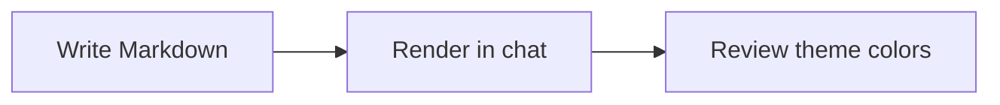

# H1 · Markdown that is easier to scan

Plain prose stays neutral. **Bold highlights a decision**, *italics add nuance*, and ***bold italics combine both***. This is ~~superseded text~~, an [underlined link](https://github.com/nicolasmendonca/ovis), and an inline command: `bun run dev`.

## H2 · Structure and emphasis

### H3 · A section you can find quickly

#### H4 · A smaller heading

##### H5 · A supporting detail

###### H6 · A quiet final level

Alternative bold: __important__. Alternative emphasis: _a small note_. Nested **bold with *emphasis inside*** and *emphasis with **bold inside*** retain their font styles.

## Lists, tasks, and quotations

- **First bullet:** keep the surrounding sentence neutral.
- Second bullet with `apps/web` and a [link](https://ovis.sh).
  - Nested item with *a useful detail*.
  - Another nested item.

1. Install dependencies with `bun install`.
2. Run the checks before publishing.
3. Review the visual preview.

- [x] Build a local preview.
- [ ] Review every theme.
- [ ] Open a pull request only after approval.

> A quotation has a colored rail, not an entire paragraph of bright color.
>
> **Important:** formatting still works inside a quotation.
> > Nested quote with *emphasis* and `inline code`.

## Tables with aligned values

| Feature | Example | Status |
| :--- | :---: | ---: |
| **Headings** | H1 through H6 | Ready |
| Inline commands | `bun test` | Ready |
| *Emphasis* | ~~old~~ → **new** | Ready |
| Links | [Ovis source](https://github.com/nicolasmendonca/ovis) | Review |

## Code and terminal commands

Run `bun install`, then `bun run dev`. Commands use inline-code styling; they are not executed by this preview.

```bash
# Install, test, and run locally
bun install
bun test
bun run dev --host 127.0.0.1
```

```typescript
interface Task {
  title: string;
  done: boolean;
}

const task: Task = { title: "Review Markdown colors", done: false };
export const label = (item: Task) => `${item.done ? "✓" : "○"} ${item.title}`;
console.log(label(task));
```

```json
{
  "preview": true,
  "publish": false,
  "themes": "all built-in variants"
}
```

```
A plain code block keeps its monospace font.
**These marks stay literal inside code.**
```

## Rules, escaping, and line breaks

A paragraph before a horizontal rule.

---

Escaped syntax: \*not italic\*, \# not a heading, and \`not inline code\`.

A source line break follows here.
This text starts on the next line.

## Mathematics and diagrams

Inline math: $E = mc^2$ and $a^2 + b^2 = c^2$.

$$
\sum_{i=1}^{n} i = \frac{n(n+1)}{2}
$$



## Images, file references, and literal fallbacks

An image reference: 

A local file reference: [Markdown renderer](src/components/Markdown.tsx).

Underline request: <u>underlined text</u>. Double underscores mean __bold__, not underline. This example intentionally shows whether the existing chat renderer supports the HTML underline tag; the color-only change does not enable raw HTML.

Common extensions to check rather than silently invent: ==highlight==, ~subscript~, ^superscript^, and a footnote reference[^1].

[^1]: A footnote definition used to reveal the renderer's actual support.

Definition term
: A definition-list example, shown as implemented by the existing renderer.

Unicode and emoji: café · 日本語 · ♟ · ✓. Nothing is communicated through color alone.

Markdown preview complete.
